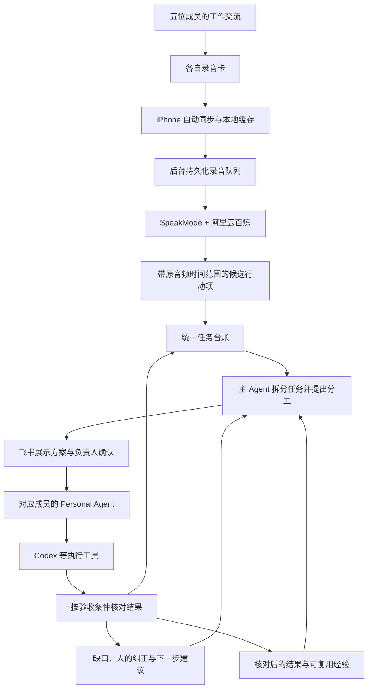

# ANC Card 协作闭环

更新于 2026-11-11，依据团队五人协作构想整理。本文描述目标架构；录音卡到货后再开始硬件与 iPhone 接入开发。

## 目标流程

日常使用目标是按录音卡按钮完成录音后，无需逐次手动分享，iPhone 自动取回录音并交给后台处理。转写继续使用自有 SpeakMode 与阿里云百炼，飞书承担团队讨论、结果展示与负责人确认。

## 各层职责

| 层 | 职责 |
| --- | --- |
| 录音卡 | 采集并保存音频；通过公开 BLE 协议提供状态与文件读取 |
| iPhone 同步层 | 绑定设备，发现新增录音，取回文件，持久化缓存并自动上传；失败后恢复 |
| 后台录音队列 | 保存原音频、导入身份、处理状态与分段检查点，处理重复上传与重启恢复 |
| SpeakMode 与百炼 | 语音识别；当前原型时间范围来自原音频分段，不是模型原生句级时间戳 |
| 主 Agent | 综合来源信息，提出行动项、分工、验收条件及后续建议 |
| 统一任务台账 | 保存任务身份、来源、负责人、状态、确认记录、执行会话与各轮结果 |
| 飞书 | 共享进展、讨论与负责人确认，更新已绑定任务卡片 |
| Personal Agent | 在分配范围内调用对应成员的工具，回传产物与执行证据 |
| 验收与知识库 | 区分执行报告与验收结果；保存纠正和经核对的经验，供后续任务引用 |

每个人、录音卡和 Personal Agent 需有明确绑定。个人录音、个人记忆和团队知识分别设置可见范围。自动执行范围和需要负责人确认的操作应显式记录。

## 两个反馈过程

任务反馈：验收发现缺口 → 将证据及补充要求写回同一任务 → 提出下一轮方案 → 按既定授权继续执行。已有 Codex 会话应沿用，并保留首轮快照。

知识沉淀：保存来源证据、已验收结果、失败原因及人的纠正，再核对其中哪些经验可推广。成功执行一次并不自动形成通用规则，也不代表模型已被训练。团队知识的更新应保留依据和版本，后续任务可以引用和纠正。

## 当前实现边界

- 已有本机 SpeakMode／百炼短音频真实转写验收，及持久化队列、重复导入、失败重试、重启恢复、分段证据和任务台账。
- 已有持久化 Codex 两轮接口演示与同会话续跑；执行方案目前限定于接口示例和 429 场景。
- 已实现飞书任务卡片与音频文件收件入口，官方 SDK 事件结构和本地传输夹具检查通过；真实测试群收件、按钮确认与原卡片回写仍待配置和实测。
- iPhone 自动同步、锁屏传输、常开后台部署、五人 Personal Agent 调度与团队知识库反馈仍是待开发目标。

硬件协议和 iPhone 后台边界见[录音卡接入核对](recording-card.md)。手动将文件发到飞书保留为调试入口，目标日常流程由 iPhone 直接上传后台。

## 到货后的第一轮验收

先用一个人、一张卡、一个任务和一个测试群验证：

1. 录制 30 秒后，iPhone 自动发现并取回文件，包含锁屏及断连重连场景。
2. 手机将文件自动上传后台，重复发送复用同一录音与任务，未完成上传可恢复。
3. SpeakMode 与百炼返回转写，行动项保留原音频时间范围，自动发布到测试群。
4. 负责人确认后执行，结果回到同一任务和原卡片；需要续跑时保留 Codex 会话与上一轮快照。
5. 一次验收纠正被保留，并在下一轮相关建议中被正确引用。

短链路成立后再验证接近真实长度的录音、弱网和多成员使用，不把短样本通过视为全天录音已验收。
