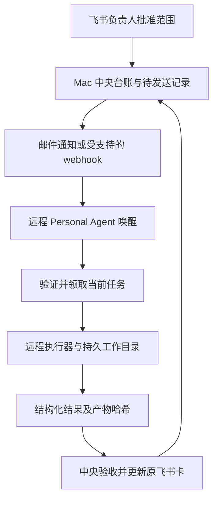

# Personal Agent、邮箱与远程电脑可行性方案

> 历史过程快照：保留当时判断与分工。今日最终状态以 [收尾审查](release-review-2026-11-14.md)、后续工作以 [当前待办](MVP-TODO.md) 为准。

日期：2026-11-14，韩国时间。性质：代码核对与官方能力调研；没有部署远程后台或验证真实邮件闭环。现有短录音 MVP 保持冻结。

后续实测更新（16:50）：已完成一次真实邮件唤醒 → Grok 云电脑 → HTTPS JSON 回执，测试监听已暂停。详见 `grok-mail-smoke-2026-11-14.md`。下文是试点前设计，远程 Codex 执行与完整后台迁移仍未验收。

## 结论

邮件可以作为任务唤醒入口；远程 Personal Agent 可以作为执行节点的候选。暂不把 Grok Bot 或 Dot 的云电脑等同于可长期托管 ANC 后台的云服务器。

当前 Personal Agent 已承担常驻队列与执行调度。`prototype/task-runner.mjs` 周期领取任务，按任务启动执行器；`codex-executor.mjs` 调用本地 CLI。用户不必保持 Codex 聊天窗口打开，但运行后台的机器必须在线。现有验收是 Mac 本地 Codex，不是 Grok、Dot 或 Claude Code 远程验收。

原有 `personal-agent-integration-2026-11-14.md` 中尚未切换服务的早期说明属于历史阶段；当前结果以 `mvp-acceptance-2026-11-14.md` 为准。

## 三种路线

| 路线 | 可以解决什么 | 必须补什么 | 决策 |
| --- | --- | --- | --- |
| Mac 队列直接启动 Codex | 飞书确认后自动干活；当前已实测 | 常驻、防睡眠、日志与恢复的长期运行验证 | 继续作为基线 |
| Mac 主后台＋远程 Personal Agent | 使用远程执行环境，未来接成员自己的 Agent | 可信派发、远程领取与回执、会话绑定、联网通道 | 下一步小试点 |
| 云端独立托管全部后台 | Mac 关机后仍收音、转写、派发、回卡 | 持久盘、固定入口、进程管理、恢复与备份、依赖迁移 | 后续部署；不因云电脑可用就判定通过 |

这里的 Personal Agent 是协调责任与执行的角色，可以由现有队列服务承担，也可以接 Grok/Dot；不必为了自动启动 CLI 多加一个 LLM 决策层。

## 官方能力与边界

### Grok Bot

- 官方支持云电脑、命令行、文件持久化，以及邮件/ webhook 触发 routine；新邮件本身不会自动唤醒，必须配置 routine。
- 自带邮箱从 routine 或来信触发的工作发送邮件时，会等待人工 Send。因此不能把自动回邮件作为已可用的无人值守结果通道。
- 电脑更新或恢复可能中断任务并移除安装包；需要可重建环境。查阅资料没有确认 ANC 所需的稳定公网入口和服务可用性保证。
- 本账号所有 Bot 共用电脑文件与 CLI 凭证，五个 Bot 并不等于五个隔离执行环境。

来源：[电脑与应用](https://docs.x.ai/grok-bot/computer-and-apps)、[事件触发](https://docs.x.ai/grok-bot/skills-routines-and-automations)、[审批](https://docs.x.ai/grok-bot/approvals-security-and-privacy)。能力是否已开放给当前账号仍需实测。

### Dot

官方说明云电脑可在本机关闭时工作，可使用配置好的 Codex 云环境；但访问已连接的本机任务仍要求本机在线、应用打开。没有据此确认常驻任意后台进程、固定公网端口或邮件事件自动触发接口。

来源：[Dot 的电脑与应用](https://learn.chatgpt.com/docs/dots/computers-and-apps)。云端新任务与当前 Mac 上的原 Codex 会话不是同一个运行环境；不能只搬一个 session ID 就宣称原会话迁移成功。

## 推荐链路

邮件只携带任务 ID、批准版本、范围摘要与领取入口，不携带长录音、长期密钥或可直接执行的邮件正文。单条任务仅发给对应负责人/Agent；群里仍只有一个主 bot。

Grok 的结果回传优先评估受支持且允许的 HTTPS 工具调用，或由中央服务读取其受支持的结果出口。先验证产品审批规则；若仍需逐次人工确认，就标半自动，不通过换 SMTP 或关闭保护绕过产品限制。

**联网前提不能省掉：**远程电脑访问不到本机 `127.0.0.1` 或家庭 `192.168.*`。Mac 留作中央后台时，需要受认证的隧道/专用网络或双方可访问的可靠消息中继；这只是使 Mac 可达，Mac 关机仍停。当前不自动开端口、不部署隧道。纯邮件往返可以另外开发服务端适配器，但 Grok 自带邮件的自动发送限制仍存在。

## 需要增加的接口契约（设计，不是现成功能）

1. 批准与待发送记录持久化为同一事务；重复投递仍使用同一 job ID。
2. `claim` 校验成员身份、taskId、approvedVersion、contractHash、有效期、未撤回状态；发放短期执行租约与唯一 runId。
3. `heartbeat` 续租；中央可撤回，失效租约不可提交结果。领取响应丢失应可查询恢复，不盲目再起一轮。
4. 绑定 taskId → workerId / workspaceId / executorSessionId。两轮留在同一执行节点；离线时等待或走显式迁移流程。
5. `complete` 校验当前 runId、版本与租约，再接收产物清单、哈希、结构化结果；中央独立测试并更新绑定的原卡。
6. 重复邮件、乱序结果、过期批准与旧执行器回执不会引发重复执行或覆盖新结果。

发件人白名单与邮件认证只是入口筛选；任务授权仍来自中央批准记录。邮箱当前没有执行授权：现有 `personal-agent.test.mjs` 会拒绝 email 作为批准渠道，不能为了接邮件删除这个边界。

## 最小试点与验收

| 顺序 | 操作 | 通过条件 |
| --- | --- | --- |
| 1 | 在一个实际远程账号确认事件触发、运行环境、依赖安装与允许的结果出口 | 留下真实回执；确认审批不会让预期自动步骤停住 |
| 2 | 用纯合成任务做邮件唤醒，只回任务 ID，不执行代码 | 接收/触发/回传可关联，重复通知只处理一次 |
| 3 | 一次飞书批准触发远程受限代码任务 | 实际产物与批准范围一致；原飞书卡更新 |
| 4 | 第二轮原会话续跑，插入重复投递、撤回和断连 | 同目录同会话；旧结果不能写回；重连无重复副作用 |
| 5 | 长时间闲置、电脑恢复、依赖重建后再测 | 任务与产物保留；无法自动恢复时明确失败且可重试 |

先完成 1–4 再决定采用 Grok 或 Dot。Grok 的事件邮件入口更明确，可优先做小试点；Dot 的 Codex 云协作有文档支持，可作为另一条候选。两者均未实测前，不给“已打通”或“可替代服务器”的结论。

## 如要完全替换 Mac 后台

- 先证明稳定 HTTPS 入口、TLS、音频上传容量与断点恢复可用。
- 验证 Node/SQLite、SpeakMode 构建、音频处理工具及供应商网络；把 Mac Keychain 读取改为目标环境的安全配置，不复制本机凭证到聊天或邮件。
- 验证数据库与原音持久化、备份恢复、进程崩溃恢复、长连接重连、资源限制与费用。
- 做 Mac 断电后的端到端测试：iPhone 上传新录音 → 真转写 → 负责人确认 → 执行 → 原卡回写。
- 最后才切换唯一主后台，防止本地与远程同时消费相同任务。

目前没有以上托管验收。为了省一个小服务器而引入多个不可控恢复环节，不利于现阶段 MVP。先保留 Mac，远程只接执行层。
